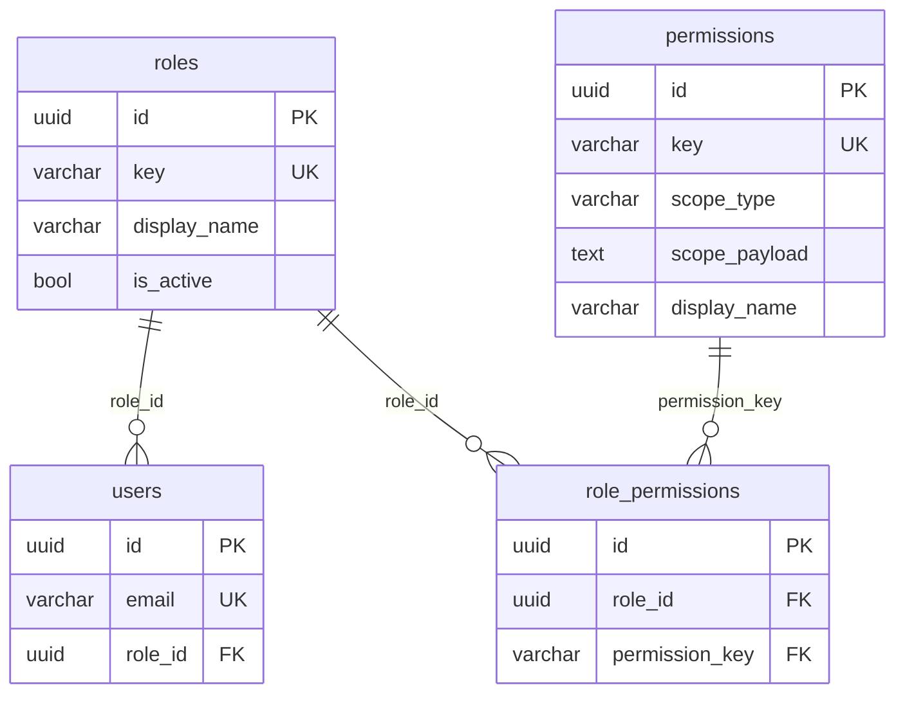

# Zuppeto - Esquema BBDD (E/R)

> Fase V tancada (14.10.2026): `AddPlaceCatalogCoveragePhase5` està aplicada a PostgreSQL real amb decisions de matching, conflictes, cicle de vida, enriquiments, checkpoints i metadades legals. El backup restaurable, `Up → Down → Up`, la publicació doble idempotent i la integritat territorial han passat; Arenys té 50 Places. [Informe](iteracio-7-fase-v-cobertura-enriquiment-deduplicacio-ca.md).

> Fase IV (14.10.2026): `AddOpenStreetMapPlaceImportPhase4` ha quedat aplicada a PostgreSQL real i afegeix fonts, execucions amb `access_mode`, registres externs, observacions per camp, ítems, incidències i decisions. `openstreetmap + OSM ID` és la identitat comuna de Geofabrik i Overpass. La restauració, la coherència EF i la publicació idempotent han passat. [Tancament](iteracio-7-fase-iv-tancament-ca.md).

> Fase III (13.10.2026): el model pet-friendly, cadenes, evidències i decisions auditades forma part del snapshot EF mitjançant `AddPetFriendlyGovernancePhase3` i `AddPetGovernanceAdminWorkflow`; validat en PostgreSQL temporal amb `Up → Down → Up`, recuperació en un context nou, idempotència i cap canvi de model pendent. Les dues migracions ja estan aplicades i verificades a PostgreSQL real. [Detall](iteracio-7-fase-iii-governanca-pet-friendly-ca.md).

## Iteració 7 — Fase II, model de Places proposat

La Fase II documenta un model futur dins `public` per separar `places`, fonts, identificadors externs, observacions per camp, decisions, deduplicació, imports/jobs i media. No forma part encara de l'EF snapshot: no s'ha creat cap migració ni modificat PostgreSQL. La definició i els constraints previstos consten a [Arquitectura, llicències i RGPD de Places](iteracio-7-fase-ii-arquitectura-llicencies-rgpd-ca.md).

Aquest document resumeix l'esquema de base de dades actual (Entity Framework snapshot), amb focus en entitats, relacions i la part d'autenticacio/autoritzacio.

## Idea clau: rol vs permis

- `roles`: cataleg de rols (taula dedicada).
- `users.role_id`: rol assignat a cada usuari.
- `permissions`: cataleg de permisos (clau, nom visible, ambit, descripcio...).
- `role_permissions`: taula pont que assigna permisos als rols (`role_id` + `permission_key`).

Model objectiu: rols amb FK reals a BD (sense strings solts per rol).

## Esquema de permisos + rols (objectiu)



## Diagrama entitat-relacio (Mermaid)

```mermaid
erDiagram
    users ||--|| favorite_lists : "owner_user_id"
    users ||--o{ place_reviews : "author_user_id"
    users ||--o{ privacy_consent_events : "user_id"

    favorite_lists ||--o{ favorite_entries : "favorite_list_id"
    places ||--o{ favorite_entries : "place_id"

    places ||--o{ place_reviews : "place_id"
    places ||--o{ place_features : "place_id"
    features ||--o{ place_features : "feature_id"
    places ||--o{ place_tags : "place_id"
    tags ||--o{ place_tags : "tag_id"

    permissions ||--o{ role_permissions : "permission_key -> permissions.key"
    menus ||--o{ menu_roles : "menu_key -> menus.key"
    menus ||--o{ menus : "parent_key -> menus.key"

    countries ||--o{ territorial_unit_types : "country_id"
    countries ||--o{ territorial_units : "country_id"
    territorial_unit_types ||--o{ territorial_units : "territorial_unit_type_id"
    territorial_units ||--o{ territorial_units : "parent_id"
    territorial_units ||--o{ users : "territorial_unit_id"
    territorial_units ||--o{ places : "territorial_unit_id"
    place_search_queries ||--o{ place_search_query_results : "query_id"
    places ||--o{ place_search_query_results : "place_id"

    users {
        uuid id PK
        varchar email UK
        varchar password_hash
        varchar role
        bool privacy_accepted
        timestamptz created_at_utc
    }

    permissions {
        uuid id PK
        varchar key UK
        varchar scope_type
        text scope_payload
        varchar display_name
        varchar description
        timestamptz created_at_utc
        timestamptz updated_at_utc
    }

    role_permissions {
        uuid id PK
        varchar role
        varchar permission_key FK
        UK "role + permission_key"
    }

    menus {
        uuid id PK
        varchar key UK
        varchar label
        varchar route
        varchar parent_key FK
        int sort_order
        bool is_active
    }

    menu_roles {
        uuid id PK
        varchar menu_key FK
        varchar role
        UK "menu_key + role"
    }

    places {
        uuid id PK
        varchar name
        varchar type
        numeric latitude
        numeric longitude
        numeric rating_average
        int review_count
    }

    place_reviews {
        uuid id PK
        uuid place_id FK
        uuid author_user_id FK
        int score
        text comment
        bool is_visible
        timestamptz created_at_utc
    }

    features {
        uuid id PK
        varchar code UK
        varchar display_name
    }

    tags {
        uuid id PK
        varchar code UK
        varchar display_name
    }

    place_features {
        uuid place_id FK
        uuid feature_id FK
        PK "place_id + feature_id"
    }

    place_tags {
        uuid place_id FK
        uuid tag_id FK
        PK "place_id + tag_id"
    }

    favorite_lists {
        uuid id PK
        uuid owner_user_id FK_UK
    }

    favorite_entries {
        uuid id PK
        uuid favorite_list_id FK
        uuid place_id FK
        timestamptz saved_at_utc
        UK "favorite_list_id + place_id"
    }

    privacy_consent_events {
        uuid id PK
        uuid user_id FK
        bool accepted
        varchar source
        timestamptz registered_at_utc
    }

    countries {
        uuid id PK
        varchar code UK
        varchar name
        int sort_order
        bool is_active
    }

    territorial_unit_types {
        uuid id PK
        uuid country_id FK
        varchar code
        varchar name
        int display_order
        bool is_selectable_locality
        bool is_active
        UK "country_id + code"
    }

    territorial_units {
        uuid id PK
        uuid country_id FK
        uuid territorial_unit_type_id FK
        uuid parent_id FK
        numeric latitude
        numeric longitude
        bool is_active
    }

    place_search_queries {
        uuid id PK
        varchar query_key UK
        varchar search_text
        varchar city
        varchar type
        varchar pet_category
        int hit_count
        int result_count
        timestamptz last_run_at_utc
        timestamptz expires_at_utc
    }

    place_search_query_results {
        uuid query_id FK
        uuid place_id FK
        int rank
        timestamptz captured_at_utc
        PK "query_id + place_id"
    }
```

## Flux de permisos (resum funcional)

1. Crear permis nou -> s'insereix una fila a `permissions`.
2. Segons `scope_type`, es desa contingut addicional a `permissions.scope_payload`:
   - `menu` -> claus de menú seleccionades
   - `page` -> URL de la pàgina objectiu
   - `action` -> `null` de moment (reservat per evolució futura)
3. Assignar aquest permis a rols -> s'insereixen files a `role_permissions` (`role`, `permission_key`).
4. Quan un usuari inicia sessio, el seu `users.role` determina quines claus de `role_permissions` rep efectivament.

## Notes de disseny

- Ponts N:M:
  - `place_features` entre `places` i `features`.
  - `place_tags` entre `places` i `tags`.
  - `role_permissions` entre rols logics i `permissions`.
  - `menu_roles` entre rols logics i `menus`.
- Jerarquia de menus per autoreferencia: `menus.parent_key -> menus.key`.
- Integritat:
  - claus uniques de cataleg (`permissions.key`, `menus.key`, `tags.code`, `features.code`, `countries.code`, etc.).
  - restriccions a `places` i `place_reviews` (rang score/rating, review_count no negatiu, etc.).
- `cities` està retirada per `20261012092916_RetireLegacyCities`; les quatre files històriques es conserven a `legacy_cities_archive`. `countries` continua com a arrel i la jerarquia publicada viu a `territorial_units`.
- `places` conserva temporalment metadades heretades de Google (`data_provenance`, `google_place_id`, cache i darrera sincronització). La Iteració 7 n'ha d'auditar i retirar la dependència després de validar fonts obertes; no són el model objectiu.
- `permissions.scope_payload` es tracta com a JSON lògic de domini, encara que físicament sigui `text`.
- `place_search_queries` i `place_search_query_results` s'utilitzen com a cache persistent i traçabilitat de cerques de `places` (patró lazy).
